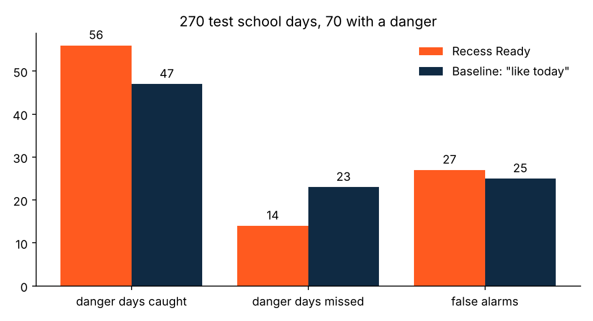
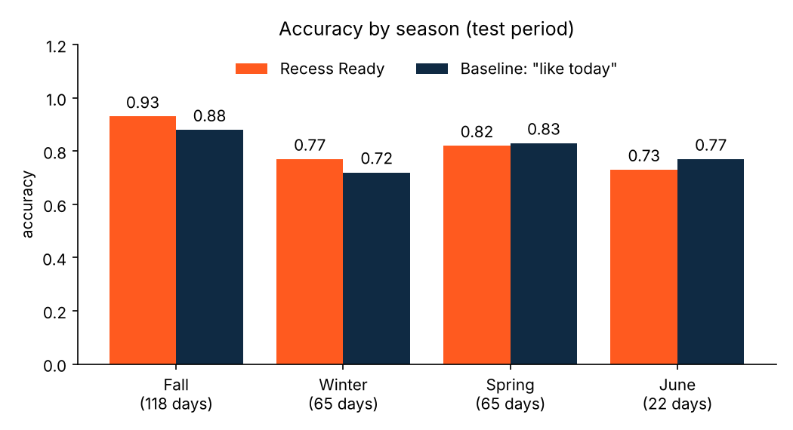
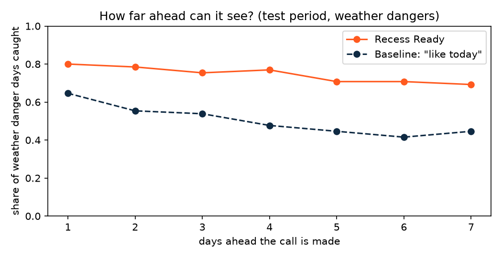

# Recess Ready: Philadelphia

**Veritas AI International High School Hackathon 2026, Climate track**

**Our research question:** can machine learning improve next-day recess decisions beyond the weather forecast plus clear danger lines? **Our answer, from two attempts: no.** Recess Ready is the tool we built along the way: a planning tool for principals, teachers and school staff in Philadelphia. Each evening it says whether **tomorrow's recess needs a change of plan**, and why: too hot, too cold, ozone smog, and more. It checks the weather forecast against danger lines for heat, cold, rain, wind and snow, and uses our machine-learning model for air quality. On 270 past school days, using the forecasts as they were issued, it caught **59 of 70** danger days with 13 false alarms. Our model alone caught 56 (27 false alarms); "tomorrow will be like today" caught 47 (25).

We first built a machine-learning model for everything. When we tested it against the plain weather forecast, the forecast won. So we tried a second, fairer way: machine learning *on top of* the forecast, learning where the forecast goes wrong. We wrote that design down first and ran it once. It did worse still (49 of 70 caught, p = 0.039 against the app). The app now uses the forecast for weather; our model's air-quality part didn't improve any call in testing either. Our main contribution is that honest evaluation, and every result is below, including the disappointing ones.

**What's new:** not another forecast, but one recess decision for school staff, made the night before with its reason; a head-to-head test of our own ML against the weather forecast itself; and a replay of every past call against real airport readings.

*Prototype, not official guidance. Always follow National Weather Service alerts and your school district's policy.*

[](https://colab.research.google.com/github/Brandozerd/veritas-climate-hackathon/blob/main/notebooks/main.ipynb)

**Demo video (1:32):** [docs/recess_ready_video.mp4](docs/recess_ready_video.mp4) · **One-page write-up:** [docs/WRITEUP.md](docs/WRITEUP.md)

## Results at a glance

On 270 test school days (September 2025 to November 2026), 70 with a danger:

| | Caught | Missed | False alarms | F1 |
|---|---|---|---|---|
| **Recess Ready** (forecast + danger lines for weather, our model for air) | **59** | **11** | **13** | **0.83** |
| Our machine-learning model alone | 56 | 14 | 27 | 0.73 |
| Baseline: "tomorrow will be like today" | 47 | 23 | 25 | 0.66 |

- Recess Ready vs our model alone: paired test p = 0.006. Vs "like today": p = 0.001.
- Our model alone vs "like today": p = 0.38, so **that difference could be luck**.
- Second try, ML on top of the forecast (design written down first, run once): caught 49 with 11 false alarms, F1 0.75. Worse than the app (p = 0.039) and than the forecast alone (p = 0.004).
- Six days ahead, the forecast with our danger lines still caught 45 of 65 weather danger days.

Where it fails: heavy rain, wind and snow had too few test days to trust; it can't alert on smoke; it can't see thunderstorms or ice. Details below.



## Who it's for

A principal or teacher deciding, the evening before, whether recess and PE go outside tomorrow. The app gives one call, the reason, and a suggested plan:

| Call | When | Suggested plan |
|---|---|---|
| **Plan indoor recess** | Alert for heat, cold, heavy rain, wind or snow | Move recess and PE indoors |
| **Outdoor recess, with limits** | Alert for air quality only | Stay outdoors with lighter activity; students with asthma follow their action plans. This follows the EPA's guidance for schools at the orange air-quality level. |
| **Outdoor recess as usual** | No alerts | No change |

A **Copy message for staff** button copies a ready-to-paste message for the staff group chat, for example: *"Recess Ready check for Thu, Dec 4: INDOOR RECESS. Alert for too cold (wind chill of 20°F or colder)."*

It is built for adult school staff. It collects no personal information and has no accounts.

## How to run it

The repo includes the data, so nothing needs to be downloaded and no API key is needed. You need **Python 3.11 or newer**.

### Option A: on your own computer

```bash
git clone https://github.com/Brandozerd/veritas-climate-hackathon.git
cd veritas-climate-hackathon
pip install -r requirements.txt
python run.py
```

When it prints `Running on local URL: http://127.0.0.1:7860`, open that address in a browser. Press Ctrl + C to stop.

### Option B: GitHub Codespaces (runs in the browser, nothing to install)

1. On the repo page, click **Code → Codespaces → Create codespace on main** and wait for setup to finish.
2. In the terminal at the bottom, run `python run.py`.
3. When the "Open in Browser" popup appears, click it (or use the **Ports** tab and open port 7860).

### Option C: as a notebook

Open `notebooks/main.ipynb` in Jupyter or VS Code and choose **Run All**. The notebook is saved with its outputs, so you can also just read it on GitHub.

The Colab badge above opens the same notebook. Its first cell downloads the rest of the project. Our team could not access Colab, so **Options A and B are the ones we tested**.

## What you should see

`python run.py` takes under a minute. It prints each step's results and then starts the app:

1. The data: 11,639 days of Philadelphia weather since 1995, and a table of danger days per year.
2. Which wind directions bring dirtier air.
3. A first model that fails (192 false alarms), then the fix.
4. `Model (alert line per danger): accuracy 0.85 | caught 56 | missed 14 | false alarms 27` (our model alone), then a shuffle test of which inputs matter.
5. Checks by season, against the real airport weather station, an hour-by-hour example from the station, across 35 places in the region, and on old forecasts made up to 7 days ahead. Then every method on the same test days, with precision, recall, F1 and paired tests: `Hybrid (what the app uses)  59  11  13 ...`.
6. **The week ahead (live):** how long the download took, then each of the next 7 days with whether it's a school day and its alerts. This needs an internet connection. Each successful download is saved to `data/live_forecast_saved.json`. If a later download fails (no internet, or the free weather service is busy), the app shows that saved week instead, labeled **"Saved forecast from [date], not live"** with a warning, so the tab is never empty. With no saved copy and no internet, it says so, and everything else still runs.
7. `Running on local URL: http://127.0.0.1:7860` — the app.

The app has three tabs. It opens in dark mode; the sun/moon switch in the header changes it.

The **Week ahead** tab is made from live Open-Meteo weather and air quality:

- **Day cards for today and the next seven days**, each with a weather icon, the feels-like high and its call (indoor, with limits, outdoor, or no school). The picked day opens into a big card with the feels-like high and low, wind and rain. It opens on the next school day. Beside the cards: the **chance of rain** for each school hour.
- **Why trust this call?** The real test results next to the call, including which alerts are tested and which are experimental.
- **Across the region:** next to the forecast map, how many of the 35 places have each alert, and the coldest and warmest spots.
- **Click a day** to see its call, plan, risk scores, staff message, the day hour by hour from 7 AM to 6 PM (lunch recess and after-school hours shaded, thunderstorms flagged), and a close-up wind map of Philadelphia. Switching days is instant: everything is already on the page.
- **Forecast map:** smooth feels-like temperature bands across 35 places in the region, Recess Ready's alert areas, and wind arrows, for the day you picked.
- **Week graph:** feels-like temperature and chance of rain, hour by hour for 7 days, with the 20 °F and 90 °F danger lines and school hours shaded.
- **Activities:** recess and PE follow the day's call. **After-school sports and clubs (3 to 6 PM)** get their own check from the hourly forecast: thunderstorms, feels-like 90 °F or 20 °F, rain chance of 60% or more, or an air-quality alert. This hourly check wasn't tested like the daily call, and the app says so.
- **Always current:** the forecast downloads each time the page opens (the downloads run at the same time; data under 10 minutes old is reused), so there's no refresh button. If a download fails, reload the page.

The **Past days** tab replays any school day from the test period: the call Recess Ready would have made the evening before, what actually happened and whether the call was right, the risk scores, the airport weather station's real readings hour by hour (lunch recess highlighted), and the wind map for the evening before.

The **Results** tab shows the test-period results and how the model works.

## Results

Every number here was printed by `notebooks/main.ipynb` with the versions in `requirements.txt`.

**Test period:** 270 school days from September 2025 to November 2026. Our model never saw them while learning. 70 of them had at least one danger.

### Every method on the same days (Step 16)

| Method | Caught | Missed | False alarms | Precision | Recall | F1 | Accuracy |
|---|---|---|---|---|---|---|---|
| **Recess Ready (hybrid)** | **59** | **11** | **13** | **0.82** | **0.84** | **0.83** | **0.91** |
| Our model alone | 56 | 14 | 27 | 0.67 | 0.80 | 0.73 | 0.85 |
| Forecast + danger lines (weather only) | 59 | 11 | 9 | 0.87 | 0.84 | 0.86 | 0.93 |
| Baseline: "like today" | 47 | 23 | 25 | 0.65 | 0.67 | 0.66 | 0.82 |

Precision: when it alerts, how often a danger really happened. Recall: of the real danger days, how many it caught. F1 balances the two.

**Is the difference real?** A paired test (McNemar's exact test) looks only at the days where one method was right and the other wasn't:
- Our model alone vs "like today": 27 days vs 20, p = 0.38. **Not significant.**
- Recess Ready vs our model alone: 26 vs 9, p = 0.006.
- Recess Ready vs "like today": 37 vs 13, p = 0.001.

**What we found.** Our machine-learning model only sees today's weather. A weather forecast comes from a physics simulation that already knows a cold front is coming. Tested on the forecasts as they were issued the day before (Open-Meteo's archive), the forecast with our own danger lines beat our model on weather dangers. So the app now uses:
- the forecast for heat, cold, rain, wind and snow;
- our model for smog and smoke, where there is no archive of old air-quality forecasts to test against.

**Our model's part didn't help on the test period.** On "any danger," the forecast alone does slightly better than the hybrid (9 false alarms instead of 13). We checked all 9 ozone days one by one:
- Our model caught 6, but all 6 were days the forecast already flagged for heat, so **it changed no call**.
- 4 of its 10 ozone false alarms fell on days with no weather alert, wrongly making them "outdoor with limits."

We kept our model for air in the app rather than make yet another change chosen by looking at the test period. A school using this today would be just as well served by the forecast alone. Our honest contribution is **the evaluation**: we built an ML model, tested it against the strongest simple alternative, and report that the simple alternative won.

**These results are exploratory.** We chose the hybrid after seeing them. No danger line or alert line was tuned on the test period, but choosing a design after looking at test results biases them in its favor. A stricter check is below: the same comparison on the 2024-25 practice year, which we hadn't compared against the forecast.

**How sure are these numbers?** 95% confidence intervals for F1, from re-scoring 2,000 random resamples of the test days:
- Hybrid: 0.76-0.89
- Forecast alone: 0.79-0.92
- Our model alone: 0.65-0.81
- "Like today": 0.57-0.75

The hybrid and the forecast alone overlap almost completely: we can't tell them apart.

Weather comes in streaks (a cold snap lasts days), so days aren't independent. Resampling whole weeks instead gives wider intervals: hybrid 0.72-0.91, forecast alone 0.76-0.92, our model 0.61-0.83, "like today" 0.53-0.76. **Our paired tests and day-level intervals don't fully account for this, so they may overstate certainty.**

The paired tests compare one school day at a time ("was the any-danger call right?"). Hybrid vs our model: 220 days both right, 26 only the hybrid right, 9 only our model right, 15 both wrong. We ran 3 tests; the two hybrid comparisons still pass a stricter cutoff for multiple tests (0.05 / 3).

### A development-period check (2024-25 practice year)

The notebook repeats the comparison on the 2024-25 practice year, using the practice-year model from Step 9 (trained only before September 2024). This is **not independent validation**: our model's alert lines were chosen on this year (which favors our model), and the year was used during development. It's a consistency check.

216 school days, 52 danger days:

| Method | Caught | Missed | False alarms | Precision | Recall | F1 | Accuracy |
|---|---|---|---|---|---|---|---|
| Recess Ready (hybrid) | 46 | 6 | 12 | 0.79 | 0.88 | 0.84 | 0.92 |
| Our model alone | 44 | 8 | 21 | 0.68 | 0.85 | 0.75 | 0.87 |
| Forecast + danger lines (weather only) | 44 | 8 | 9 | 0.83 | 0.85 | 0.84 | 0.92 |
| Baseline: "like today" | 35 | 17 | 18 | 0.66 | 0.67 | 0.67 | 0.84 |

- **Weather dangers only:** the forecast caught 43 of 48 with 10 false alarms. Our model caught 41 with 21, even with its alert lines chosen on this year. "Like today" caught 32 with 19.
- **Hybrid vs our model alone:** 16 days only the hybrid was right, 5 only our model, p = 0.027.

**The main finding looks the same on a second period:** the forecast beats our model on weather dangers, and the hybrid beats our model alone. Here our model's air part did help a little (2 more danger days caught than the forecast alone, for 3 more false alarms), unlike on the test period.

For description only (the two periods have different histories, so this is not a validation claim), accuracy across both periods (486 school days): forecast + danger lines 0.92, Recess Ready 0.91, our model alone 0.86, "like today" 0.83.

### Second try: machine learning on top of the forecast

Our first model only saw today's weather, so it lost to the forecast. A fairer job for machine learning is to start from the forecast and learn where it goes wrong. **We wrote the design down in the notebook before running it, and ran it once on the test period** (Step 16, "Second try").

- **Dangers:** too hot and too cold (the only weather dangers with enough practice-year days: 11 hot, 32 cold). Rain, wind and snow keep the plain forecast; air keeps our first model.
- **Inputs:** tomorrow's forecast, how far it is from each danger line, and today's real weather.
- **Training:** the 2024-25 practice year (216 school days), the only year with saved old forecasts before the test period. Alert lines chosen inside that year with blocked cross-validation (`MISS_COST = 2`).

On the 270 test days (70 danger days):

| Method | Caught | Missed | False alarms | Precision | Recall | F1 | Accuracy |
|---|---|---|---|---|---|---|---|
| Forecast + ML (second try) | 49 | 21 | 11 | 0.82 | 0.70 | 0.75 | 0.88 |
| Recess Ready (hybrid) | 59 | 11 | 13 | 0.82 | 0.84 | 0.83 | 0.91 |
| Forecast + danger lines (weather only) | 59 | 11 | 9 | 0.87 | 0.84 | 0.86 | 0.93 |

- **Paired tests:** forecast + ML vs the app: only forecast + ML right on 2 days, only the app on 10, p = 0.039. Vs the forecast alone: 2 days vs 14, p = 0.004.
- **Heat:** caught 7 of 16 hot days (plain forecast: 15). With 11 hot days to learn from, it chose a very cautious alert line (0.95).
- **Cold:** caught 36 of 45 (plain forecast: 41), with 1 false alarm (forecast: 2).

**The finding holds from two directions:** ML did not beat the forecast plus danger lines, whether it competed with the forecast or built on it. The likely reason is that the forecast comes from physics simulations of the whole atmosphere, and one year is far too little data to learn its mistakes. Caveat: we had already seen the test period, so this is a second look at the same exam and is exploratory.

### Does a "danger day" mean a dangerous recess?

Our labels use whole days ("too cold" = the day's lowest feels-like, usually around dawn). We checked them against the airport's real feels-like from 11 AM to 1 PM on test school days:

| Danger | Labeled days | Also past the line at recess | Typical recess feels-like |
|---|---|---|---|
| Too cold (20 °F) | 45 | 15 | 22.9 °F |
| Too hot (90 °F) | 16 | 6 | 89.2 °F |

On no other test day did recess cross a line. So **our labels are cautious**: a "too cold" day is a cold day, but at recess it was usually a few degrees above our line. Recess Ready flags more days than recess-hour readings alone would. Predicting recess-hour conditions directly is a next step.


### Weather dangers only

The table above scores every method against all 70 danger days, including 14 air-danger days the forecast can't see. A cleaner test of the forecast, on the same 270 days with 65 weather danger days:

| Method | Caught | Missed | False alarms | Precision | Recall | F1 | Accuracy |
|---|---|---|---|---|---|---|---|
| **Forecast + danger lines** (= the hybrid's weather part) | **58** | **7** | **10** | **0.85** | **0.89** | **0.87** | **0.94** |
| Our model alone | 52 | 13 | 24 | 0.68 | 0.80 | 0.74 | 0.86 |
| Baseline: "like today" | 42 | 23 | 21 | 0.67 | 0.65 | 0.66 | 0.84 |

**Forecast timing.** The archive gives the value forecast 24 hours before each hour. So the day's high (afternoon) and low (dawn) were forecast by the afternoon or dawn of the day before, which is available for an evening decision. For the late-evening hours of the target day, the forecast came after an 8 PM decision; this barely affects daily highs and lows, but slightly helps rain totals. The live app uses the newest forecast from the same service. Open-Meteo's archive of past runs covers weather models, not air quality, which is why air dangers can't be compared this way.

### Recess Ready, by danger

| Danger | Decided by | Real days | Caught | Missed | False alarms | Precision | Recall |
|---|---|---|---|---|---|---|---|
| Too cold | forecast | 45 | 41 | 4 | 2 | 0.95 | 0.91 |
| Too hot | forecast | 16 | 15 | 1 | 4 | 0.79 | 0.94 |
| Ozone smog | our model | 9 | 6 | 3 | 10 | 0.38 | 0.67 |
| Smoke and particles | our model | 5 | 0 | 5 | 0 | none | 0.00 |
| Dangerous wind | forecast | 5 | 0 | 5 | 2 | 0.00 | 0.00 |
| Heavy rain | forecast | 3 | 2 | 1 | 5 | 0.29 | 0.67 |
| Heavy snow | forecast | 1 | 1 | 0 | 1 | 0.50 | 1.00 |

Rain, wind and snow had too few test days to trust either way. Wind gusts are estimated in the old forecasts, which likely explains 0 of 5 wind days; the live app uses real gust forecasts.

### Our model alone, by danger

| Danger | Real days | Recess Ready caught | Recess Ready false alarms | Baseline caught | Baseline false alarms |
|---|---|---|---|---|---|
| Too cold | 45 | 42 | 17 | 33 | 8 |
| Too hot | 16 | 10 | 7 | 8 | 6 |
| Ozone smog | 9 | 6 | 10 | 5 | 7 |
| Smoke and particles | 5 | 0 | 0 | 1 | 5 |
| Dangerous wind | 5 | 0 | 0 | 0 | 4 |
| Heavy rain | 3 | 0 | 0 | 0 | 6 |
| Heavy snow | 1 | 0 | 0 | 1 | 4 |

Our model alone catches more cold, heat and ozone days than the baseline, but with more false alarms; on those three dangers its overall accuracy (0.86) is the same as the baseline's (0.87). It gives **no alerts at all** for the four rare ones.

### Does it work equally well across seasons and places?

These checks are for **our model alone** (we ran them before the forecast comparison; we didn't have time to repeat them for the hybrid).

**By season** (accuracy on "any danger tomorrow"):

| Season | School days | Danger days | Recess Ready | Baseline | Danger days Recess Ready missed |
|---|---|---|---|---|---|
| Fall | 118 | 7 | 0.93 | 0.88 | 5 |
| Winter | 65 | 45 | 0.77 | 0.72 | 3 |
| Spring | 65 | 10 | 0.82 | 0.83 | 6 |
| June | 22 | 8 | 0.73 | 0.77 | 0 |



It is better than the baseline in fall and winter and slightly worse in spring and June. It is weakest in June, and in fall it misses 5 of the 7 danger days (mostly rain, wind and ozone).

**By place (a regional consistency test, not proof it works elsewhere):** we ran the Philadelphia model, frozen (no retraining, same alert lines), on a regular grid of 35 places across southeastern Pennsylvania, South Jersey and northern Delaware. Accuracy ranged from **0.81 to 0.86** (Center City: 0.85). The weakest places are in South Jersey, toward the coast.

### What the model looks at

We shuffled one input at a time on the test period and counted how much worse the alerts got (a "shuffle test," or permutation importance). For the weather dangers, the inputs that matter most are the **3-day average feels-like low** (accuracy drops 2.1 points when it's shuffled), the **north-south part of the wind direction** (1.9) and the **time of year** (1.6). For the air dangers, the top three are the **change in feels-like low since yesterday** (1.0), **fine particles (PM2.5)** (0.9) and the **air quality index** (0.7). The drops are small because several inputs carry the same information (today's low, yesterday's low and the 3-day average), so they share the credit.

Scikit-learn's quick built-in ranking said wind direction (east-west part) mattered most. The shuffle test showed it barely matters. The built-in ranking over-credits inputs the trees split on often, so we report the shuffle test. Chart: `docs/feature_importance.png`.

### How far ahead can it see?

The app shows a week, so we tested calls made 1 to 7 days ahead, using Open-Meteo's archive of old forecasts (Step 16): weather dangers only, on the same test school days. 65 of the 270 test school days had a weather danger.

| Days ahead | Forecast + danger lines: caught | False alarms | Our model alone: caught | False alarms | "Like today": caught | False alarms |
|---|---|---|---|---|---|---|
| 1 (tomorrow) | **58** | **10** | 52 | 24 | 42 | 21 |
| 2 | **53** | **5** | 51 | 30 | 36 | 24 |
| 3 | **54** | **5** | 49 | 24 | 35 | 28 |
| 4 | **52** | **12** | 50 | 24 | 31 | 34 |
| 5 | **49** | **7** | 46 | 24 | 29 | 33 |
| 6 | 45 | **11** | **46** | 25 | 27 | 33 |
| 7 | not tested | | 45 | 25 | 29 | 34 |

The forecast with our danger lines is the best of the three up to 5 days ahead. By 6 days ahead it catches about as many as our model, with fewer false alarms. "Like today" falls off fast. The archive only goes back 6 days, so 7 days ahead is untested for the forecast.

Limits: weather dangers only (no archive of old air forecasts); gusts are estimated; for our model, the 1-day row uses measured weather, so it isn't exactly comparable with its other rows.



### Checked against real sensors

Our weather history comes from a weather model (Open-Meteo), so we compared it with the real weather station at Philadelphia International Airport for the test period.

- The two agreed on **98-99% of days** for heat, cold, heavy rain and wind.
- In degrees, our feels-like temperatures are typically **3-4 °F apart** from the station's (within 8 °F on 87-96% of days), and **run 2-3 °F colder on average**. So we probably flag slightly more cold days and slightly fewer hot days than the station would.
- The forecast made the day before was typically **1.6-2.2 °F off** from what happened; six days ahead, **3.4-3.8 °F**.

**Why another weather app shows different numbers:** it uses a different forecast source, often shows the actual air temperature rather than feels-like (on a windy winter day those differ by 8 °F or more), uses your exact location rather than one point in Center City, and its big number is "right now" rather than the day's high or low.
- Scored against the station (those four dangers): Recess Ready caught **45** and missed **12**; the baseline caught 38 and missed 19. Recess Ready had 31 false alarms and the baseline 24.

### Where it fails

- **Our machine-learning model lost to the plain forecast on weather dangers.** This is our biggest finding. The app uses the forecast for weather and keeps our model for smog and smoke, but even there it didn't improve any call in testing.
- **Rain, wind and snow are barely tested.** The test period had only 3 heavy-rain days, 5 wind days and 1 snow day. The forecast caught 2 of 3 rain days and 0 of 5 wind days (with estimated gusts). The app labels these alerts "not well tested."
- **No smoke alerts.** Our model never alerts on smoke and particles (0 of 5 caught).
- **Ozone alerts are noisy:** 6 of 9 caught, but 10 false alarms.
- **Thunderstorms and ice are invisible to it.** Open-Meteo's history recorded zero of either, so we couldn't train on them. The airport station reported **12 thunderstorm days and 4 freezing-rain days** in the test period. The app flags thunderstorms in the hourly forecast and tells staff to check the National Weather Service.
- **"Too cold" is the day's lowest feels-like temperature**, usually around dawn, not during recess. Our danger lines are for whole days.
- **We looked at test results while building.** Earlier versions were scored on the test period (see the timeline), and we chose the hybrid after seeing the forecast comparison. Danger lines and alert lines were never tuned on it, but the reported results are exploratory, not an independent confirmation.
- **Our labels are cautious.** On 30 of the 45 "too cold" test days, the airport's feels-like at recess was above 20 °F (typically about 23 °F).
- **Our ML model added nothing to the calls on the test period.** Every ozone day it caught was already flagged for heat.
- **The truth is weather-model data** (ERA5), not sensors. We checked it against the airport station (98-99% agreement), but couldn't do the same for air quality.
- **Risk scores are not percent chances.** We told the model to pay extra attention to rare dangers, which inflates their scores. The app shows a 0-100 "risk score" with an alert line instead.
- **One reading for the whole city.** The data can't tell neighborhoods apart.
- **The live calls can't be scored yet.** Every result above is from the test period. The air-quality forecast only reaches about 5 days, so after that the app says air quality wasn't checked. If forecast data is missing, the app makes no call instead of a reassuring one.
- **Holidays in the test.** The test counts every weekday from September to June as a school day. The live week ahead skips weekends, federal holidays and the School District of Philadelphia's 2026-27 days off (`NO_SCHOOL_DAYS`, Step 17).
- **Some thresholds are our own settings** (20 °F, 1 inch of rain, 2 inches of snow). A district would set its own.

### Development timeline (from our git history, Eastern time)

So judges can see which results we looked at before each decision:

| When | What happened |
|---|---|
| Fri, before kickoff | Repo skeleton only: this file's template, folders, `.gitignore`. |
| Sat 12:39 PM | Started the notebook: data, dangers. |
| Sat 1:31 PM | First model, time split, baseline, **first look at test results**. |
| Sat 1:45 PM | One shared alert line, chosen on the practice year. |
| Sat 4:57 PM | After seeing test results (missed 42 of 45 cold days): 30 years of weather, two forests. |
| Sat 5:53 PM | Per-danger alert lines on the practice year (miss = 2x false alarm), trend inputs. **The model has not changed since.** |
| Sat 7:20-8:34 PM | Live forecast, airport station checks, days-ahead test on old forecasts. |
| Sun 12:22 AM | Audit: tested the forecast + danger lines on the test period; it beat our model, so **we switched the app to the hybrid after seeing that result**. |
| Sun, later | Per-danger and ozone checks, confidence intervals, recess-hour check, and the practice-year check above. |
| Sun ~11:45 AM | Second try: ML on top of the forecast. Design written into the notebook first, then run once; it lost (above). The app was not changed. |

### What we tried that didn't work

These came from earlier versions of the notebook during the weekend:

1. **Three years of training data.** The model missed 42 of 45 cold days in the winter of 2025-26, which was colder than anything it had seen. We moved to 30 years of weather.
2. **One alert line for every danger.** With a shared cutoff of 0.65, it caught 55 danger days but raised 142 false alarms. The current notebook still shows this problem in Step 8: at a shared 0.5, heavy rain alone causes 186 false alarms for 3 real days.

## How it works

- **Data:** daily Philadelphia weather since 1995 and air quality since August 2022, from Open-Meteo. 6,897 school days, 1,752 of them danger days.
- **Inputs:** today's weather, wind, air quality and season, plus trends from the last three days. Nothing from tomorrow.
- **Model:** two random forests (scikit-learn). One learns the five weather dangers from 30 years. The other learns the two air dangers from the years that have air data.
- **Split by time:** train before September 2025, test after. Never shuffled.
- **Alert lines:** each danger gets its own, chosen on the 2024-25 school year with one rule: a missed danger day costs twice as much as a false alarm. The test period is not used for this.
- **Baselines:** "tomorrow's dangers are the same as today's," and a tougher one: the weather forecast for that day, made the day before, with our danger lines.
- **The call the app makes (the hybrid):** weather dangers from the forecast plus our danger lines (it beat our model in testing); air dangers from our model. Each day shows a "Forecast check" with every number next to its danger line, and our model's risk scores as a second opinion.
- **Live:** the app downloads the last 3 days and the next 7 from Open-Meteo's free forecast API for Philadelphia and the 35 region places. Nothing is retrained. If forecast data is missing, it makes no call. Past the ~5-day air forecast, it says air quality wasn't checked.

A side finding: Philadelphia's dirtiest air arrives on winds from the south and southwest (average AQI 83, against 60 on north winds). Hot days also go with worse air (correlation 0.53). That is a pattern, not proof of cause.

`docs/TEACH_BACK.md` explains each step in plain words.

## What's in this repo

```
README.md               this file
run.py                  runs the notebook's code and starts the app
requirements.txt        exact library versions
notebooks/main.ipynb    the whole project, saved with its outputs
data/                   saved data (Open-Meteo and the airport station)
project/static/         the map script we wrote, and the Leaflet map library
docs/                   the write-up, the demo video, charts, screenshots and the teach-back guide
practice/               pre-hackathon practice notes (nothing from here is used)
CLAUDE.md               our instructions for the AI coding assistant
```

To download fresh data, delete the CSV files in `data/` and run again. To re-save the notebook with outputs:

```bash
cd notebooks
RECESS_SKIP_APP=1 jupyter nbconvert --to notebook --execute --inplace main.ipynb
```

## Credits

**Data**
- [Open-Meteo](https://open-meteo.com/) historical weather API (ERA5 reanalysis, Copernicus), forecast API (for the live call) and air quality API (CAMS, Copernicus). Free, no key, CC BY 4.0.
- [Iowa Environmental Mesonet](https://mesonet.agron.iastate.edu/request/download.phtml), Iowa State University: hourly reports from the Philadelphia International Airport weather station (PHL). Used to check our data and for the Past days tab's hour-by-hour view.
- School District of Philadelphia 2026-27 school calendar: the days off for students, entered by our team in `NO_SCHOOL_DAYS` (Step 17).
- Map tiles © [OpenStreetMap](https://www.openstreetmap.org/copyright) contributors.

**Guidance behind the thresholds and advice**
- US EPA / AirNow, [Air Quality and Outdoor Activity Guidance for Schools](https://www.airnow.gov/publications/air-quality-index/air-quality-and-outdoor-activity-guidance-for-schools/), and the EPA Air Quality Index levels.
- National Weather Service heat index chart ("Extreme Caution" starts at 90 °F) and Wind Advisory criteria (gusts of 46 mph or more).
- The cold, rain and snow thresholds are our own settings.

**Software**
- Python libraries: pandas, NumPy, scikit-learn, SciPy, Matplotlib, Gradio, Requests, Jupyter.
- [Leaflet](https://leafletjs.com/) 1.9.4 map library (BSD 2-Clause), included in `project/static/leaflet/` with its license.
- Fonts: Geist and Instrument Serif, loaded from Google Fonts (SIL Open Font License).

**Demo video**
- Voiceover: [Kokoro](https://huggingface.co/hexgrad/Kokoro-82M) text-to-speech (Apache 2.0), run with [kokoro-onnx](https://github.com/thewh1teagle/kokoro-onnx) (MIT). The voice is a blend of its `af_heart` and `af_jessica` voices. It is an AI voice, not a person.
- Pictures: drawn frame by frame in Python with Pillow and NumPy, joined with FFmpeg. The app screens are screenshots of our own app (Past days tab, Monday, January 26, 2026, a test-period day).
- Music: an original piano score generated by our own Python code (no samples, no copyrighted music).
- Font: Inter (SIL Open Font License).

**Design references**
- The forecast map borrows the look of the National Weather Service national forecast chart.

## AI tools used

- **Claude Code** (Anthropic's AI coding assistant) wrote most of the code and this README from our instructions. We chose the idea, the user, the dangers and the "a miss costs double" rule; ran every version ourselves; and reported the results that came out, including the ones that failed.
- Inside Claude Code we used these add-on skills: frontend-design, impeccable, apple-design and anti-ui-slop (visual design guidance), webapp-testing (browser screenshots to check the app), llm-council (to argue over project ideas), and find-skill (to find the others).
- **ChatGPT** (OpenAI): we used it to review the project like a judge would. Its critiques led us to add the forecast baseline, the recess-hour label check, the development-period check and the confidence intervals. All code and every number came from our notebook.
- **Kokoro TTS** (open-source AI voice): reads the script in our demo video.
- For the video, Claude Code wrote the Python that draws the animation and the music, following its video-design skill. We wrote the script's ideas, picked the style and the voice, and checked every number against the notebook.
- *Team: add any other AI tool you used here.*

## Team

- Brandon — app, charts, video and demo
- Faadi Garcia — write-up, sources and AI tools
