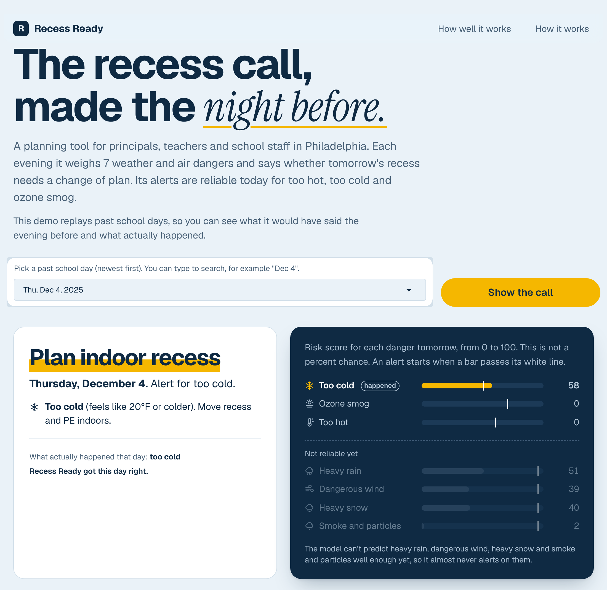
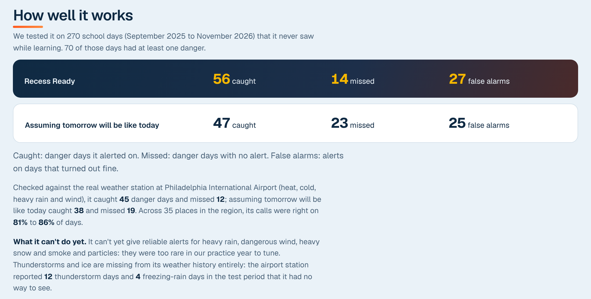

# Recess Ready: Philadelphia

**Veritas AI International High School Hackathon 2026, Climate track**

Recess Ready is a planning tool for principals, teachers and school staff in Philadelphia. Each evening it looks at today's weather and air quality and says whether **tomorrow's recess needs a change of plan**, and why: too hot, too cold, or ozone smog. On 270 school days it had never seen, it caught **56 of 70** danger days. The simple guess "tomorrow will be like today" caught 47.

*Prototype, not official guidance. Always follow National Weather Service alerts and your school district's policy.*

[](https://colab.research.google.com/github/Brandozerd/veritas-climate-hackathon/blob/main/notebooks/main.ipynb)



## Who it's for

A principal or teacher deciding, the evening before, whether recess and PE go outside tomorrow. The app gives one call, the reason, and a suggested plan:

| Call | When | Suggested plan |
|---|---|---|
| **Plan indoor recess** | Alert for heat, cold, heavy rain, wind or snow | Move recess and PE indoors |
| **Outdoor recess, with limits** | Alert for air quality only | Stay outdoors with lighter activity; students with asthma follow their action plans. This follows the EPA's guidance for schools at the orange air-quality level. |
| **Outdoor recess as usual** | No alerts | No change |

A **Copy message for staff** button copies a ready-to-paste message for the staff group chat, for example: *"Recess Ready check for Thu, Dec 4: INDOOR RECESS. Alert for too cold (wind chill of 20°F or colder)."*

It is built for adult school staff. It collects no personal information and has no accounts.

## How to run it

The repo includes the data, so nothing needs to be downloaded and no API key is needed. You need **Python 3.11 or newer**.

### Option A: on your own computer

```bash
git clone https://github.com/Brandozerd/veritas-climate-hackathon.git
cd veritas-climate-hackathon
pip install -r requirements.txt
python run.py
```

When it prints `Running on local URL: http://127.0.0.1:7860`, open that address in a browser. Press Ctrl + C to stop.

### Option B: GitHub Codespaces (runs in the browser, nothing to install)

1. On the repo page, click **Code → Codespaces → Create codespace on main** and wait for setup to finish.
2. In the terminal at the bottom, run `python run.py`.
3. When the "Open in Browser" popup appears, click it (or use the **Ports** tab and open port 7860).

### Option C: as a notebook

Open `notebooks/main.ipynb` in Jupyter or VS Code and choose **Run All**. The notebook is saved with its outputs, so you can also just read it on GitHub.

The Colab badge above opens the same notebook. Its first cell downloads the rest of the project. Our team could not access Colab, so **Options A and B are the ones we tested**.

## What you should see

`python run.py` takes under a minute. It prints each step's results and then starts the app:

1. The data: 11,639 days of Philadelphia weather since 1995, and a table of danger days per year.
2. Which wind directions bring dirtier air.
3. A first model that fails (192 false alarms), then the fix.
4. `Model (alert line per danger): accuracy 0.85 | caught 56 | missed 14 | false alarms 27`
5. Checks by season, against the real airport weather station, and across 35 places in the region.
6. `Running on local URL: http://127.0.0.1:7860` — the app.

In the app, pick a past school day. You get the call the tool would have made the evening before, what actually happened, a risk score for each danger, two maps you can zoom, and the air-quality reading.

## Results

Every number here was printed by `notebooks/main.ipynb` with the versions in `requirements.txt`.

**Test period:** 270 school days from September 2025 to November 2026. The model never saw them while learning. 70 of them had at least one danger.

| | Danger days caught | Missed | False alarms | Accuracy |
|---|---|---|---|---|
| Baseline: "tomorrow will be like today" | 47 | 23 | 25 | 0.82 |
| **Recess Ready** | **56** | **14** | 27 | **0.85** |

Recess Ready caught 9 more danger days for 2 more false alarms.



### By danger

| Danger | Real days | Recess Ready caught | Recess Ready false alarms | Baseline caught | Baseline false alarms |
|---|---|---|---|---|---|
| Too cold | 45 | 42 | 17 | 33 | 8 |
| Too hot | 16 | 10 | 7 | 8 | 6 |
| Ozone smog | 9 | 6 | 10 | 5 | 7 |
| Smoke and particles | 5 | 0 | 0 | 1 | 5 |
| Dangerous wind | 5 | 0 | 0 | 0 | 4 |
| Heavy rain | 3 | 0 | 0 | 0 | 6 |
| Heavy snow | 1 | 0 | 0 | 1 | 4 |

The model beats the baseline on the three common dangers. It gives **no alerts at all** for the four rare ones (see "Where it fails").

### Fairness: does it work equally well across groups?

**By season** (accuracy on "any danger tomorrow"):

| Season | School days | Danger days | Recess Ready | Baseline | Danger days Recess Ready missed |
|---|---|---|---|---|---|
| Fall | 118 | 7 | 0.93 | 0.88 | 5 |
| Winter | 65 | 45 | 0.77 | 0.72 | 3 |
| Spring | 65 | 10 | 0.82 | 0.83 | 6 |
| June | 22 | 8 | 0.73 | 0.77 | 0 |

It is better than the baseline in fall and winter and slightly worse in spring and June. It is weakest in June, and in fall it misses 5 of the 7 danger days (mostly rain, wind and ozone).

**By place:** we ran the Philadelphia model, without retraining, on 35 places across southeastern Pennsylvania, South Jersey and northern Delaware. Accuracy ranged from **0.81 to 0.86** (Center City: 0.85). The weakest places are in South Jersey, toward the coast.

### Checked against real sensors

Our weather history comes from a weather model (Open-Meteo), so we compared it with the real weather station at Philadelphia International Airport for the test period.

- The two agreed on **98-99% of days** for heat, cold, heavy rain and wind.
- Scored against the station (those four dangers): Recess Ready caught **45** and missed **12**; the baseline caught 38 and missed 19. Recess Ready had 31 false alarms and the baseline 24.

### Where it fails

- **Rare dangers are switched off.** Heavy rain, dangerous wind, heavy snow and smoke were too rare in our practice year to set an alert line, so the model never alerted on them. Those dangers happened 14 times in the test period and it caught none. The app marks them "not reliable yet." Example: 1 inch of rain on October 30, 2025, with no alert.
- **Thunderstorms and ice are invisible to it.** Open-Meteo's history recorded zero of either, so we couldn't train on them. The airport station reported **12 thunderstorm days and 4 freezing-rain days** in the test period.
- **Ozone alerts are noisy:** 6 caught, but 10 false alarms.
- **Its scores are not percent chances.** We told the model to pay extra attention to rare dangers, which inflates their scores. The app shows a 0-100 "risk score" with an alert line instead.
- **One reading for the whole city.** The data can't tell neighborhoods apart.
- **Air quality is a computer-model estimate** (CAMS), not sensor readings, and only goes back to August 2022.
- **Holidays are ignored.** Every weekday from September to June counts as a school day.
- **Some thresholds are our own settings** (20 °F, 1 inch of rain, 2 inches of snow). A district would set its own.

### What we tried that didn't work

These came from earlier versions of the notebook during the weekend:

1. **Three years of training data.** The model missed 42 of 45 cold days in the winter of 2025-26, which was colder than anything it had seen. We moved to 30 years of weather.
2. **One alert line for every danger.** With a shared cutoff of 0.65, it caught 55 danger days but raised 142 false alarms. The current notebook still shows this problem in Step 8: at a shared 0.5, heavy rain alone causes 186 false alarms for 3 real days.

## How it works

- **Data:** daily Philadelphia weather since 1995 and air quality since August 2022, from Open-Meteo. 6,897 school days, 1,752 of them danger days.
- **Inputs:** today's weather, wind, air quality and season, plus trends from the last three days. Nothing from tomorrow.
- **Model:** two random forests (scikit-learn). One learns the five weather dangers from 30 years. The other learns the two air dangers from the years that have air data.
- **Split by time:** train before September 2025, test after. Never shuffled.
- **Alert lines:** each danger gets its own, chosen on the 2024-25 school year with one rule: a missed danger day costs twice as much as a false alarm. The test period is not used for this.
- **Baseline:** tomorrow's dangers are the same as today's.

A side finding: Philadelphia's dirtiest air arrives on winds from the south and southwest (average AQI 83, against 60 on north winds). Hot days also go with worse air (correlation 0.53). That is a pattern, not proof of cause.

`docs/TEACH_BACK.md` explains each step in plain words.

## What's in this repo

```
README.md               this file
run.py                  runs the notebook's code and starts the app
requirements.txt        exact library versions
notebooks/main.ipynb    the whole project, saved with its outputs
data/                   saved data (Open-Meteo and the airport station)
project/static/         the map script we wrote, and the Leaflet map library
docs/                   screenshots and the teach-back guide
practice/               pre-hackathon practice notes (nothing from here is used)
CLAUDE.md               our instructions for the AI coding assistant
```

To download fresh data, delete the CSV files in `data/` and run again. To re-save the notebook with outputs:

```bash
cd notebooks
RECESS_SKIP_APP=1 jupyter nbconvert --to notebook --execute --inplace main.ipynb
```

## Credits

**Data**
- [Open-Meteo](https://open-meteo.com/) historical weather API (ERA5 reanalysis, Copernicus) and air quality API (CAMS, Copernicus). Free, no key, CC BY 4.0.
- [Iowa Environmental Mesonet](https://mesonet.agron.iastate.edu/request/download.phtml), Iowa State University: hourly reports from the Philadelphia International Airport weather station (PHL).
- Map tiles © [OpenStreetMap](https://www.openstreetmap.org/copyright) contributors.

**Guidance behind the thresholds and advice**
- US EPA / AirNow, [Air Quality and Outdoor Activity Guidance for Schools](https://www.airnow.gov/publications/air-quality-index/air-quality-and-outdoor-activity-guidance-for-schools/), and the EPA Air Quality Index levels.
- National Weather Service heat index chart ("Extreme Caution" starts at 90 °F) and Wind Advisory criteria (gusts of 46 mph or more).
- The cold, rain and snow thresholds are our own settings.

**Software**
- Python libraries: pandas, NumPy, scikit-learn, SciPy, Matplotlib, Gradio, Requests, Jupyter.
- [Leaflet](https://leafletjs.com/) 1.9.4 map library (BSD 2-Clause), included in `project/static/leaflet/` with its license.
- Fonts: Geist and Instrument Serif, loaded from Google Fonts (SIL Open Font License).

**Design references**
- The regional alert map borrows the look of the National Weather Service national forecast chart.

## AI tools used

- **Claude Code** (Anthropic's AI coding assistant) wrote most of the code and this README from our instructions. We chose the idea, the user, the dangers and the "a miss costs double" rule; ran every version ourselves; and reported the results that came out, including the ones that failed.
- Inside Claude Code we used these add-on skills: frontend-design, impeccable, apple-design and anti-ui-slop (visual design guidance), webapp-testing (browser screenshots to check the app), llm-council (to argue over project ideas), and find-skill (to find the others).
- *Team: add any other AI tool you used here, for example GitHub Copilot or ChatGPT.*

## Team

- [NAME] — main engineer
- Brandon — app, charts and video
- [NAME] — write-up
